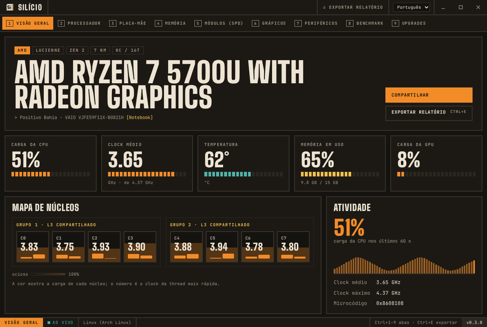
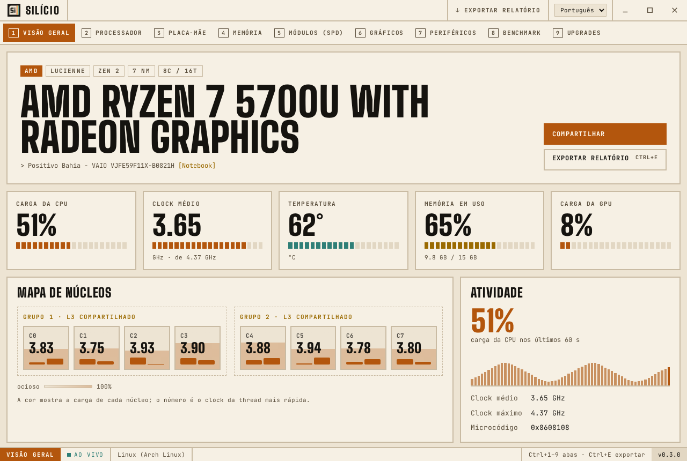
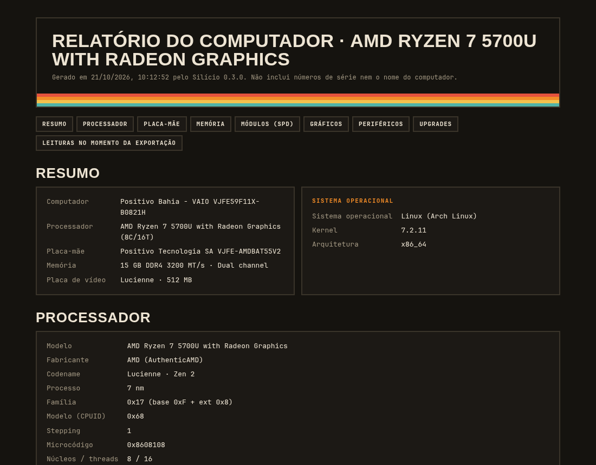
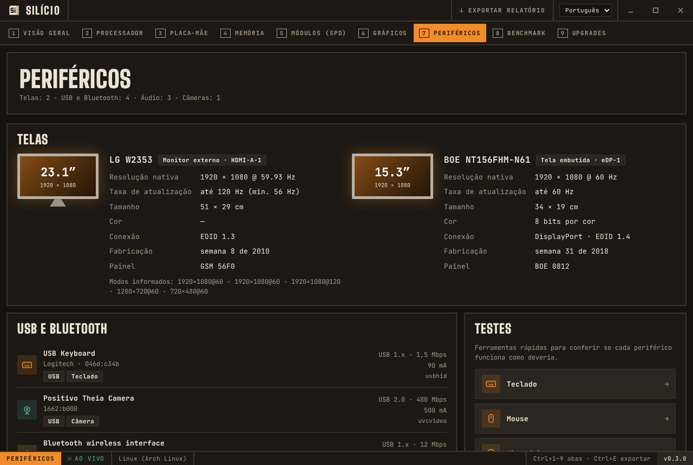
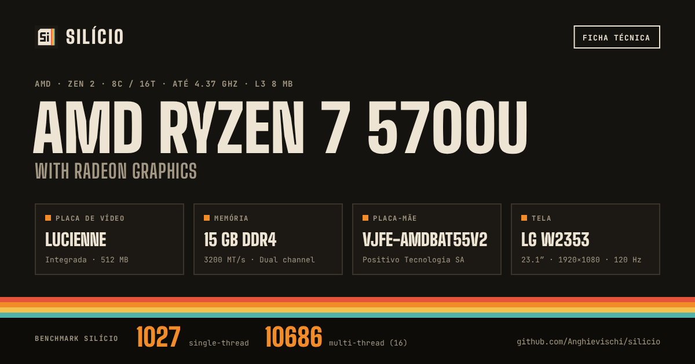
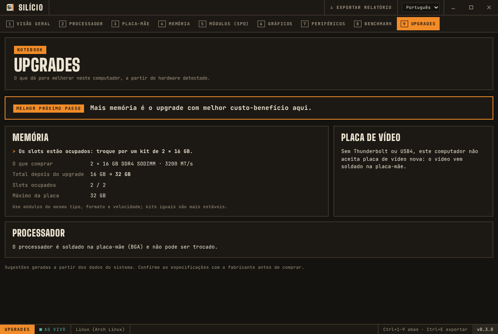

<div align="center">


# Silício

**A modern, open-source alternative to CPU-Z for Linux and Windows.**
Processor, motherboard, memory, SPD and graphics card, with live data and a clean interface.

[](https://github.com/Anghievischi/silicio/releases/latest)
[](https://github.com/Anghievischi/silicio/releases)
[](https://github.com/Anghievischi/silicio/actions/workflows/ci.yml)
[](LICENSE)


[Download](#download) · [Features](#features) · [Installation](#installation) · [Building](#building-from-source) · [Contributing](#contributing) · 🇧🇷 [Leia em português](README.pt-BR.md)



</div>

## Download

| System | Direct download |
|--------|-----------------|
| **Windows 10/11**: installer | [⬇ Silicio-setup.exe](https://github.com/Anghievischi/silicio/releases/latest/download/Silicio-setup.exe) |
| **Windows 10/11**: portable, no install | [⬇ Silicio-portable.exe](https://github.com/Anghievischi/silicio/releases/latest/download/Silicio-portable.exe) |
| **Windows**: MSI (managed deployment) | [⬇ Silicio.msi](https://github.com/Anghievischi/silicio/releases/latest/download/Silicio.msi) |
| **Ubuntu, Debian, Mint, Pop!_OS** | [⬇ Silicio-amd64.deb](https://github.com/Anghievischi/silicio/releases/latest/download/Silicio-amd64.deb) |
| **Fedora, openSUSE** | [⬇ Silicio-x86_64.rpm](https://github.com/Anghievischi/silicio/releases/latest/download/Silicio-x86_64.rpm) |
| **Any Linux**: AppImage | [⬇ Silicio-x86_64.AppImage](https://github.com/Anghievischi/silicio/releases/latest/download/Silicio-x86_64.AppImage) |

These links always point to the latest version. Older versions are on the [releases page](https://github.com/Anghievischi/silicio/releases).

## Features

| | CPU-Z | Silício |
|---|:---:|:---:|
| Overview dashboard with animated gauges for CPU, memory and GPU | ❌ | ✅ |
| Live core map grouped like the chip (shared L3 groups / AMD CCX, Intel P and E cores) | ❌ | ✅ |
| CPU name, codename, process, family/model/stepping, instructions, caches | ✅ | ✅ |
| Live clock per thread, with history chart | Clocks window | ✅ |
| CPU temperature and load per thread | ❌ | ✅ |
| Core voltage, real bus clock, socket | ✅ | ✅ Linux ¹ |
| Motherboard, BIOS, chipset, PCIe link of each GPU | ✅ | ✅ |
| Memory type, channels, frequency, installed modules | ✅ | ✅ |
| Memory diagnostics (single channel, XMP disabled, mixed kits) | ❌ | ✅ |
| SPD: manufacturer, part number, date, JEDEC timings table | ✅ | ✅ DDR4 ² |
| XMP / EXPO profiles | ✅ | Detection only |
| Graphics: clocks, load, temperature, power, VRAM | ✅ | ✅ |
| CPU benchmark (single/multi thread) and stress test with throttling detection | ✅ | ✅ |
| Full report export: readable HTML page, Markdown for forums, raw JSON | TXT only | ✅ |
| Shareable specs card (PNG, dark or light) with benchmark score | Online validation | ✅ |
| Upgrade suggestions: which graphics card fits, how much memory to add, the socket's fastest CPU | ❌ | ✅ |
| Displays: model, panel, size, native resolution, refresh range, HDR, manufacture date (EDID) | ❌ | ✅ |
| USB and Bluetooth devices with speed, power and function; peripheral batteries (Linux) | ❌ | ✅ |
| Audio devices with current format; cameras with resolutions and frame rates | ❌ | ✅ |
| Keyboard, mouse polling rate, speaker, dead pixel and camera tests | ❌ | ✅ |
| Native Linux version | ❌ | ✅ |
| Light and dark theme | ❌ | ✅ |
| Interface in English and Portuguese, switchable live | Several languages | ✅ |

¹ Reads model-specific registers through a small root helper started with `pkexec`; the system asks for your password once.
² DDR5 is detected but not decoded yet.

<details>
<summary><b>More screenshots</b></summary>

| Memory | SPD |
|---|---|
|  |  |
| **Graphics** | **Motherboard** |
|  |  |
| **Processor** | **Light theme** |
|  |  |
| **Benchmark** | **Exported report** |
|  |  |
| **Peripherals** | **Shareable card** |
|  |  |
| **Upgrades** | |
|  | |

</details>

## Installation

### Windows 10 and 11

Download **[Silicio-setup.exe](https://github.com/Anghievischi/silicio/releases/latest/download/Silicio-setup.exe)**, open it and follow the steps, or run **[Silicio-portable.exe](https://github.com/Anghievischi/silicio/releases/latest/download/Silicio-portable.exe)** without installing.

> [!IMPORTANT]
> Releases are not code-signed yet, so Windows SmartScreen may show "Windows protected your PC". Click **More info** → **Run anyway**.

**With [Scoop](https://scoop.sh):**

```powershell
scoop bucket add silicio https://github.com/Anghievischi/silicio
scoop install silicio
```

Windows 10 and 11 already include WebView2, which the app uses. If it is missing, the installer downloads it.

If the app does not open, look for `silicio-crash.log` in your temp folder (type `%TEMP%` in the Explorer address bar) and attach it to a [bug report](https://github.com/Anghievischi/silicio/issues/new?template=bug_report.yml).

### Linux

**Ubuntu, Debian, Mint, Pop!_OS**

```bash
wget https://github.com/Anghievischi/silicio/releases/latest/download/Silicio-amd64.deb
sudo apt install ./Silicio-amd64.deb
```

**Fedora, openSUSE**

```bash
sudo dnf install https://github.com/Anghievischi/silicio/releases/latest/download/Silicio-x86_64.rpm
```

**Any distribution (AppImage)**

```bash
wget https://github.com/Anghievischi/silicio/releases/latest/download/Silicio-x86_64.AppImage
chmod +x Silicio-x86_64.AppImage
./Silicio-x86_64.AppImage
```

**Arch Linux**: use the AppImage, convert the `.deb` with `debtap`, or [build from source](#building-from-source).

The `.deb` and `.rpm` packages include the root helper and its polkit rule. The AppImage does not, so socket, voltage and real bus clock are not shown there.

If the **SPD** tab is empty, load the SPD EEPROM driver for your memory type:

```bash
sudo modprobe ee1004     # DDR4
sudo modprobe spd5118    # DDR5
```

## Usage

- **Ctrl+1** to **Ctrl+8** switch between tabs.
- **Share** on the Overview creates a PNG card with your specs (and your last benchmark score) to post anywhere; it can also be copied straight to the clipboard.
- The **Peripherals** tab has quick tests: keyboard (every key plus how many keys register at once), mouse polling rate and buttons, left/right speakers, dead pixels in full screen and camera.
- **Export report** (bottom of the sidebar, or **Ctrl+E**) saves everything Silício collected to your Downloads folder: an HTML page that is easy to read and print to PDF, Markdown to paste on GitHub or forums, or the raw JSON. Serial numbers and the computer name are never included.
- The installed version is shown at the bottom of the sidebar; click it to see what changed.
- The language follows your system; change it at the bottom of the sidebar.
- **Copy JSON** on the Processor tab copies the processor data.
- When a new version is out, Silício offers to update itself (Windows installer, `.deb`, `.rpm` and AppImage). Updates are signed and checked before installing.
- From a terminal, `silicio --json` prints the report for every tab without opening a window (on Windows: `Silicio.exe --json > report.json`).
- `silicio --bench` runs the CPU benchmark (5 s single-thread + 5 s multi-thread) and prints the scores as JSON.

## How it works

Silício reads hardware information through public interfaces only:

| Data | Linux | Windows |
|------|-------|---------|
| CPU identification, caches, instructions | `CPUID` instruction | `CPUID` instruction |
| Clocks, load, RAM usage | `sysinfo` (cpufreq) | `sysinfo` |
| Temperatures, GPU sensors | hwmon (`k10temp`, `coretemp`, `amdgpu`) | NVML (NVIDIA) |
| Motherboard, BIOS, memory modules | DMI in sysfs, SMBIOS decoded by udev | WMI |
| Chipset, PCIe links | `/sys/bus/pci` + `pci.ids` | planned |
| SPD EEPROM | `ee1004` / `spd5118` drivers | planned (PawnIO) |
| Voltage, real bus clock, socket | MSR + raw SMBIOS through the root helper | planned (PawnIO) |
| Graphics | `amdgpu`, `i915`, `xe` sysfs + NVML | WMI + NVML |

Codenames, JEDEC tables and memory vendor IDs come from public documentation and are written from scratch.

## Reverse engineering notes

Silício is a **clean-room reimplementation**. CPU-Z was studied only to list *which* information it shows; no CPU-Z code, data table or image is used.

- **Source:** `cpuz_x64.exe` from CPU-Z 3.01 (SHA-256 `a01369043c9e199747d62b950fb6db3f793ea74feb9c667ae291988405905fbe`).
- **Tools used:** REA, a reverse-engineering toolkit, for static analysis only: PE resource tree, dialog templates and embedded files. The program was never executed and its code was not decompiled.
- **What was done:** every tab, field and auxiliary window was inventoried from the dialog resources, and the three embedded kernel drivers were identified. The full inventory and a CPU-Z ↔ Silício coverage table are in [`docs/analise-cpu-z.md`](docs/analise-cpu-z.md).
- **Verification:** the SPD decoder is tested against `decode-dimms` (i2c-tools) on real modules.

## Building from source

Requirements: [Rust](https://rustup.rs) (stable), [Node.js](https://nodejs.org) 20+ and [pnpm](https://pnpm.io). On Linux also `webkit2gtk-4.1`; see the [Tauri prerequisites](https://v2.tauri.app/start/prerequisites/).

```bash
git clone https://github.com/Anghievischi/silicio.git
cd silicio
pnpm install
pnpm tauri dev          # run in development mode
pnpm tauri build        # build installers into src-tauri/target/release/bundle
```

Tests and checks:

```bash
pnpm check
cd src-tauri && cargo test && cargo clippy --all-targets
```

To try the root helper during development:

```bash
cd src-tauri && cargo build && pkexec "$PWD/target/debug/silicio-helper" | jq
```

<details>
<summary><b>Project structure</b></summary>

```
src/                          interface (SvelteKit SPA)
  routes/                     one folder per tab
  lib/components/             Sidebar, Card, Sparkline
  lib/types.ts                types mirroring the Rust structs
src-tauri/src/
  lib.rs                      Tauri commands and --json mode
  hw/cpu.rs                   processor (CPUID, sysfs, sysinfo)
  hw/codenames.rs             Intel/AMD codename table
  hw/board.rs                 system, motherboard, BIOS, chipset
  hw/memory.rs                RAM and modules
  hw/spd.rs                   DDR4 SPD decoder (JEDEC 21-C)
  hw/gpu.rs                   graphics (sysfs, NVML, WMI)
  hw/pci.rs                   PCI devices and PCIe links
  hw/privileged.rs            MSR and raw SMBIOS (helper only)
  hw/wmi.rs                   WMI queries (Windows)
  bench.rs                    CPU benchmark and stress test
  bin/silicio-helper.rs       root helper, started with pkexec
src-tauri/tests/fixtures/     real SPD dump used by the tests
packaging/                    icon and polkit policy
docs/                         CPU-Z analysis and screenshots
```

</details>

## Roadmap

- [x] Processor, motherboard, memory, SPD (DDR4), graphics and benchmark tabs
- [x] Overview dashboard, live core map and report export
- [x] Root helper for MSR and SMBIOS on Linux
- [ ] XMP / EXPO profile decoding and DDR5 SPD
- [ ] Privileged readings on Windows with the PawnIO driver
- [x] English and Portuguese interface
- [ ] More translations (contributions welcome)
- [x] Peripherals tab (displays, USB/Bluetooth, audio, cameras) with interactive tests
- [x] Shareable specs card
- [x] Upgrade suggestions and a retro look with a custom title bar
- [ ] Camera formats and peripheral batteries on Windows
- [ ] Waybar module, Prometheus/MQTT export, temperature alerts
- [ ] Online benchmark comparison

Ideas and votes are welcome in [issues](https://github.com/Anghievischi/silicio/issues).

## Contributing

Contributions of every size help: a bug report with your `silicio --json` output, a missing CPU codename, a translation or a pull request. Read [CONTRIBUTING.md](CONTRIBUTING.md) to get started and follow the [Code of Conduct](CODE_OF_CONDUCT.md). To report a security issue, see [SECURITY.md](SECURITY.md).

## Similar projects

| Project | Platform | Notes |
|---------|----------|-------|
| [CPU-Z](https://www.cpuid.com/softwares/cpu-z.html) | Windows, Android | The original, freeware |
| [CPU-X](https://github.com/TheTumultuousUnicornOfDarkness/CPU-X) | Linux, FreeBSD | CPU-Z-like, no longer maintained |
| [LibreHardwareMonitor](https://github.com/LibreHardwareMonitor/LibreHardwareMonitor) | Windows | Sensors and monitoring |
| [HWiNFO](https://www.hwinfo.com) | Windows | Detailed sensors, freeware |

## License

Silício is free software under the [MIT License](LICENSE).

**Disclaimer:** Silício is not affiliated with or endorsed by CPUID. CPU-Z is a trademark of CPUID. Other product names are trademarks of their respective owners.
