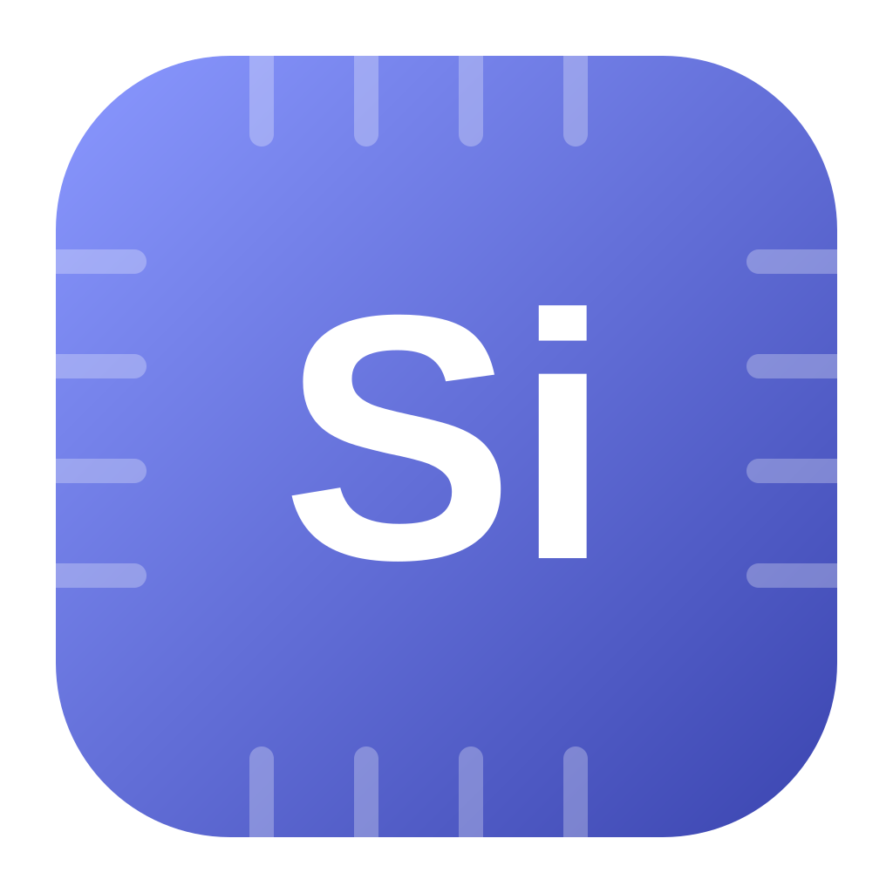
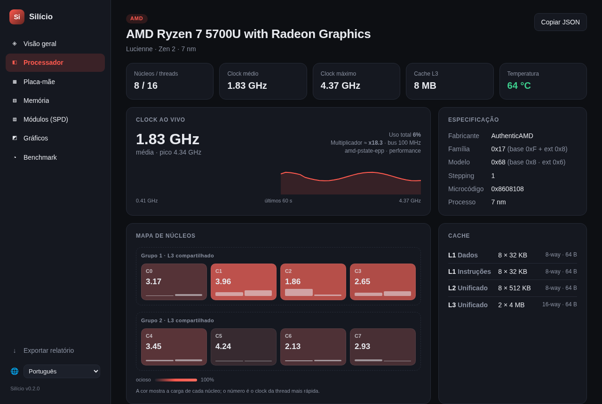
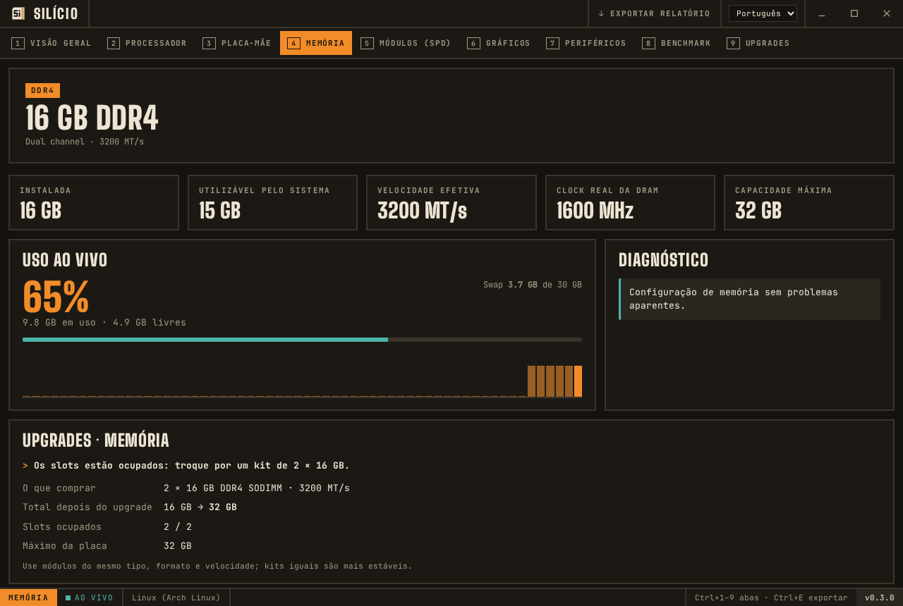
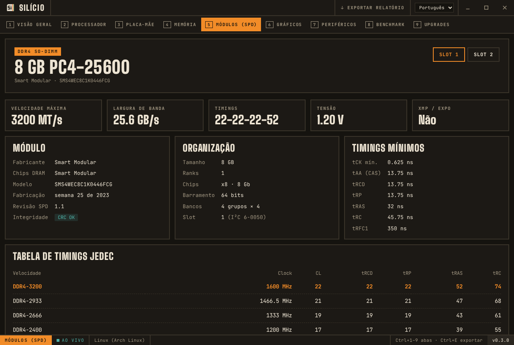
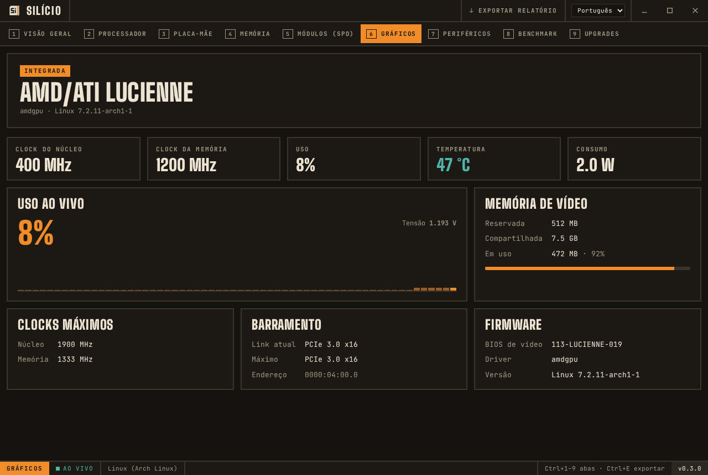
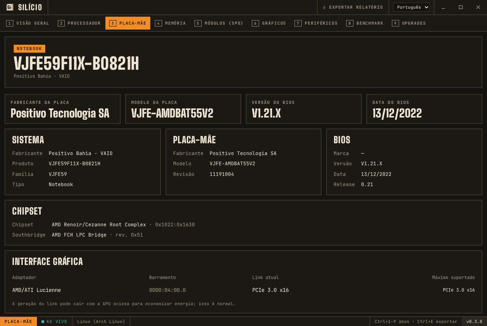
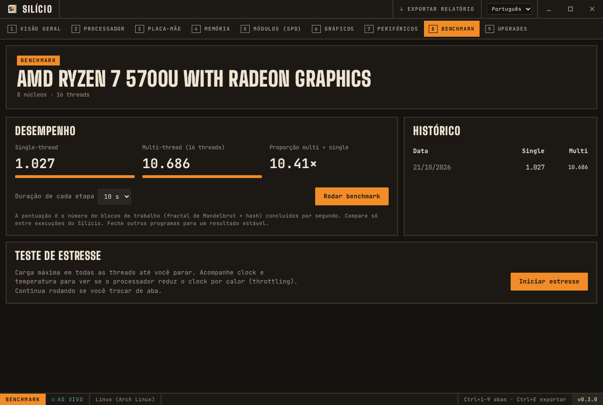
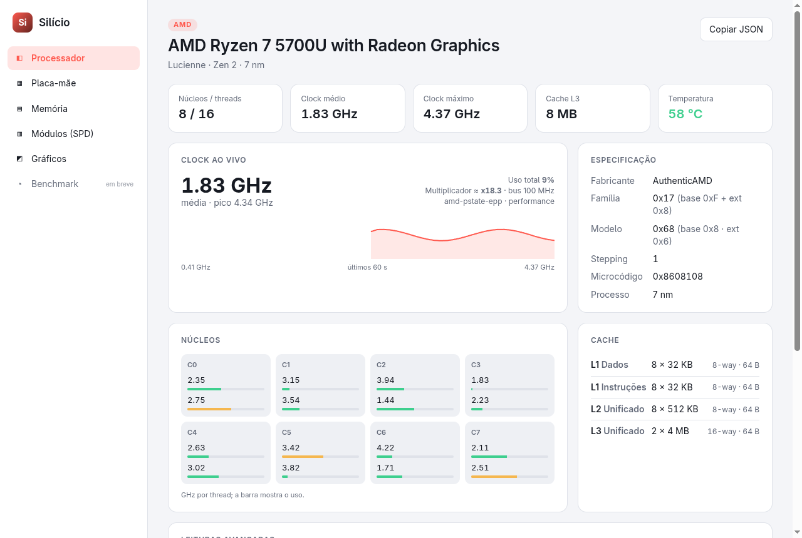

<div align="center">



# Silício

**Uma alternativa moderna e de código aberto ao CPU-Z, para Linux e Windows.**
Processador, placa-mãe, memória, SPD e placa de vídeo, com dados ao vivo e visual limpo.

[](https://github.com/Anghievischi/silicio/releases/latest)
[](https://github.com/Anghievischi/silicio/releases)
[](https://github.com/Anghievischi/silicio/actions/workflows/ci.yml)
[](LICENSE)


[Download](#download) · [Recursos](#recursos) · [Instalação](#instalação) · [Compilando](#compilando-a-partir-do-código) · [Contribuindo](#contribuindo) · 🇺🇸 [Read in English](README.md)



</div>

## Download

| Sistema | Download direto |
|---------|-----------------|
| **Windows 10/11**: instalador | [⬇ Silicio-setup.exe](https://github.com/Anghievischi/silicio/releases/latest/download/Silicio-setup.exe) |
| **Windows 10/11**: portátil, sem instalar | [⬇ Silicio-portable.exe](https://github.com/Anghievischi/silicio/releases/latest/download/Silicio-portable.exe) |
| **Windows**: MSI (empresas) | [⬇ Silicio.msi](https://github.com/Anghievischi/silicio/releases/latest/download/Silicio.msi) |
| **Ubuntu, Debian, Mint, Pop!_OS** | [⬇ Silicio-amd64.deb](https://github.com/Anghievischi/silicio/releases/latest/download/Silicio-amd64.deb) |
| **Fedora, openSUSE** | [⬇ Silicio-x86_64.rpm](https://github.com/Anghievischi/silicio/releases/latest/download/Silicio-x86_64.rpm) |
| **Qualquer Linux**: AppImage | [⬇ Silicio-x86_64.AppImage](https://github.com/Anghievischi/silicio/releases/latest/download/Silicio-x86_64.AppImage) |

Os links sempre apontam para a versão mais recente. As anteriores estão na [página de releases](https://github.com/Anghievischi/silicio/releases).

## Recursos

| | CPU-Z | Silício |
|---|:---:|:---:|
| Nome, codinome, processo, família/modelo/stepping, instruções e caches da CPU | ✅ | ✅ |
| Clock ao vivo por thread, com gráfico | Janela Clocks | ✅ |
| Temperatura e uso da CPU por thread | ❌ | ✅ |
| Tensão do núcleo, bus real, soquete | ✅ | ✅ Linux ¹ |
| Placa-mãe, BIOS, chipset, link PCIe de cada GPU | ✅ | ✅ |
| Tipo, canais e frequência da memória, módulos instalados | ✅ | ✅ |
| Diagnóstico de memória (single channel, XMP desligado, kits diferentes) | ❌ | ✅ |
| SPD: fabricante, modelo, data, tabela de timings JEDEC | ✅ | ✅ DDR4 ² |
| Perfis XMP / EXPO | ✅ | Só detecção |
| Gráficos: clocks, uso, temperatura, consumo, VRAM | ✅ | ✅ |
| Benchmark de CPU (single/multi thread) e teste de estresse com detecção de throttling | ✅ | ✅ |
| Relatório em JSON (`--json`) | Só TXT | ✅ |
| Versão nativa para Linux | ❌ | ✅ |
| Tema claro e escuro | ❌ | ✅ |

¹ Lê registradores da CPU por um pequeno helper com root, iniciado via `pkexec`; o sistema pede sua senha uma vez.
² DDR5 é reconhecido, mas ainda não decodificado.

<details>
<summary><b>Mais screenshots</b></summary>

| Memória | SPD |
|---|---|
|  |  |
| **Gráficos** | **Placa-mãe** |
|  |  |
| **Benchmark** | **Tema claro** |
|  |  |

</details>

## Instalação

### Windows 10 e 11

Baixe o **[Silicio-setup.exe](https://github.com/Anghievischi/silicio/releases/latest/download/Silicio-setup.exe)**, abra e siga os passos. Se não quiser instalar, use o **[Silicio-portable.exe](https://github.com/Anghievischi/silicio/releases/latest/download/Silicio-portable.exe)**: é só abrir.

> [!IMPORTANT]
> Os arquivos ainda não têm assinatura digital, então o Windows SmartScreen pode mostrar "O Windows protegeu o computador". Clique em **Mais informações** → **Executar assim mesmo**.

O Windows 10 e 11 já trazem o WebView2 que o app usa. Se faltar, o instalador baixa sozinho.

Se o app não abrir, procure o arquivo `silicio-crash.log` na pasta temporária (digite `%TEMP%` na barra de endereço do Explorer) e anexe num [relato de bug](https://github.com/Anghievischi/silicio/issues/new?template=bug_report.yml).

### Linux

**Ubuntu, Debian, Mint, Pop!_OS**

```bash
wget https://github.com/Anghievischi/silicio/releases/latest/download/Silicio-amd64.deb
sudo apt install ./Silicio-amd64.deb
```

**Fedora, openSUSE**

```bash
sudo dnf install https://github.com/Anghievischi/silicio/releases/latest/download/Silicio-x86_64.rpm
```

**Qualquer distribuição (AppImage)**

```bash
wget https://github.com/Anghievischi/silicio/releases/latest/download/Silicio-x86_64.AppImage
chmod +x Silicio-x86_64.AppImage
./Silicio-x86_64.AppImage
```

**Arch Linux**: use o AppImage, converta o `.deb` com o `debtap` ou [compile a partir do código](#compilando-a-partir-do-código).

Os pacotes `.deb` e `.rpm` incluem o helper com root e a regra do polkit. O AppImage não inclui, então soquete, tensão e bus real não aparecem nele.

Se a aba **SPD** ficar vazia, carregue o driver do EEPROM SPD do seu tipo de memória:

```bash
sudo modprobe ee1004     # DDR4
sudo modprobe spd5118    # DDR5
```

## Uso

- **Ctrl+1** a **Ctrl+6** trocam de aba.
- **Copiar JSON**, na aba Processador, copia o relatório completo: útil para relatar bugs e pedir ajuda em fóruns.
- No terminal, `silicio --json` imprime o relatório de todas as abas sem abrir janela (no Windows: `Silicio.exe --json > relatorio.json`).
- `silicio --bench` roda o benchmark de CPU (5 s single-thread + 5 s multi-thread) e imprime as pontuações em JSON.

## Como funciona

O Silício lê o hardware só por interfaces públicas:

| Dado | Linux | Windows |
|------|-------|---------|
| Identificação da CPU, caches, instruções | instrução `CPUID` | instrução `CPUID` |
| Clocks, uso, memória em uso | `sysinfo` (cpufreq) | `sysinfo` |
| Temperaturas, sensores da GPU | hwmon (`k10temp`, `coretemp`, `amdgpu`) | NVML (NVIDIA) |
| Placa-mãe, BIOS, módulos de memória | DMI no sysfs, SMBIOS decodificado pelo udev | WMI |
| Chipset, links PCIe | `/sys/bus/pci` + `pci.ids` | planejado |
| EEPROM SPD | drivers `ee1004` / `spd5118` | planejado (PawnIO) |
| Tensão, bus real, soquete | MSR + SMBIOS bruto pelo helper com root | planejado (PawnIO) |
| Gráficos | sysfs de `amdgpu`, `i915`, `xe` + NVML | WMI + NVML |

Codinomes, tabelas JEDEC e códigos de fabricantes de memória vêm de documentação pública e foram escritos do zero.

## Notas de engenharia reversa

O Silício é uma **reimplementação clean-room**. O CPU-Z foi estudado só para listar *quais* informações ele mostra; nenhum código, tabela ou imagem do CPU-Z é usado.

- **Fonte:** `cpuz_x64.exe` do CPU-Z 3.01 (SHA-256 `a01369043c9e199747d62b950fb6db3f793ea74feb9c667ae291988405905fbe`).
- **Ferramentas usadas:** REA, um kit de engenharia reversa, só em análise estática: árvore de recursos do PE, templates de diálogo e arquivos embutidos. O programa nunca foi executado e o código dele não foi descompilado.
- **O que foi feito:** todas as abas, campos e janelas auxiliares foram inventariados a partir dos recursos de diálogo, e os três drivers de kernel embutidos foram identificados. O inventário completo e uma tabela de cobertura CPU-Z ↔ Silício estão em [`docs/analise-cpu-z.md`](docs/analise-cpu-z.md).
- **Verificação:** o decodificador de SPD é testado contra o `decode-dimms` (i2c-tools) em módulos reais.

## Compilando a partir do código

Requisitos: [Rust](https://rustup.rs) (estável), [Node.js](https://nodejs.org) 20+ e [pnpm](https://pnpm.io). No Linux, também o `webkit2gtk-4.1`; veja os [pré-requisitos do Tauri](https://v2.tauri.app/start/prerequisites/).

```bash
git clone https://github.com/Anghievischi/silicio.git
cd silicio
pnpm install
pnpm tauri dev          # roda em modo de desenvolvimento
pnpm tauri build        # gera os instaladores em src-tauri/target/release/bundle
```

Testes e verificações:

```bash
pnpm check
cd src-tauri && cargo test && cargo clippy --all-targets
```

Para testar o helper com root durante o desenvolvimento:

```bash
cd src-tauri && cargo build && pkexec "$PWD/target/debug/silicio-helper" | jq
```

A estrutura do projeto está descrita no [README em inglês](README.md#building-from-source).

## Roteiro

- [x] Abas de processador, placa-mãe, memória, SPD (DDR4), gráficos e benchmark
- [x] Helper com root para MSR e SMBIOS no Linux
- [ ] Decodificação de perfis XMP / EXPO e SPD DDR5
- [ ] Leituras com privilégio no Windows com o driver PawnIO
- [ ] Interface em inglês e traduções
- [ ] Card de specs para compartilhar, módulo para Waybar, exportação Prometheus/MQTT, alertas de temperatura
- [ ] Comparação de benchmark online

Ideias e votos são bem-vindos nas [issues](https://github.com/Anghievischi/silicio/issues).

## Contribuindo

Toda ajuda conta: um relato de bug com a saída do `silicio --json`, um codinome de CPU que falta, uma tradução ou um pull request. Leia o [CONTRIBUTING.md](CONTRIBUTING.md) para começar e siga o [Código de Conduta](CODE_OF_CONDUCT.md). Para relatar uma falha de segurança, veja o [SECURITY.md](SECURITY.md).

## Projetos similares

| Projeto | Plataforma | Observações |
|---------|------------|-------------|
| [CPU-Z](https://www.cpuid.com/softwares/cpu-z.html) | Windows, Android | O original, freeware |
| [CPU-X](https://github.com/TheTumultuousUnicornOfDarkness/CPU-X) | Linux, FreeBSD | Parecido com o CPU-Z, não é mais mantido |
| [LibreHardwareMonitor](https://github.com/LibreHardwareMonitor/LibreHardwareMonitor) | Windows | Sensores e monitoramento |
| [HWiNFO](https://www.hwinfo.com) | Windows | Sensores detalhados, freeware |

## Licença

O Silício é software livre sob a [Licença MIT](LICENSE).

**Aviso:** o Silício não tem vínculo nem aprovação da CPUID. CPU-Z é marca registrada da CPUID. Os demais nomes de produtos são marcas de seus respectivos donos.
